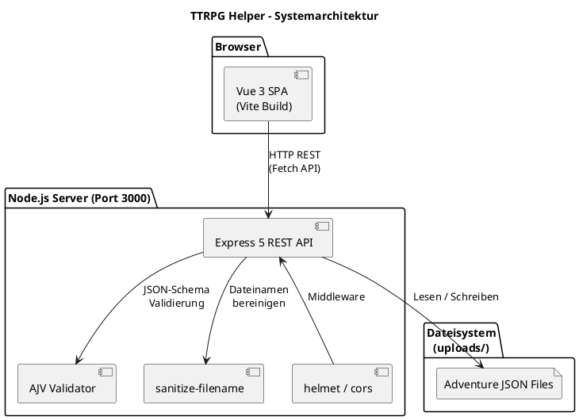
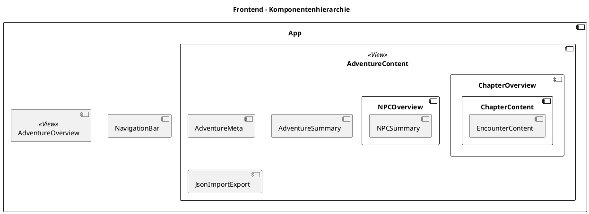
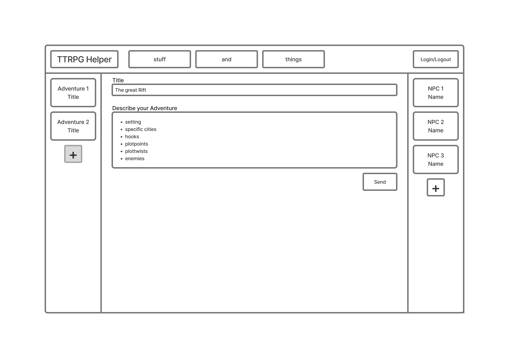
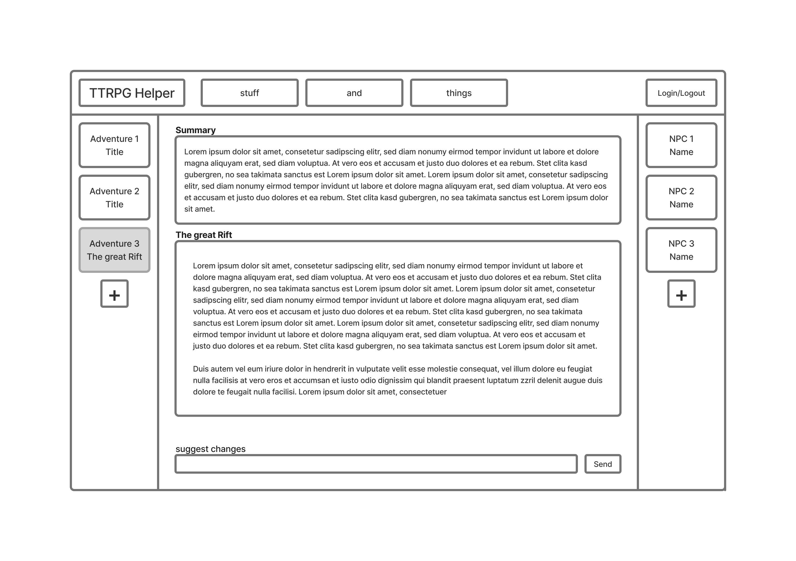
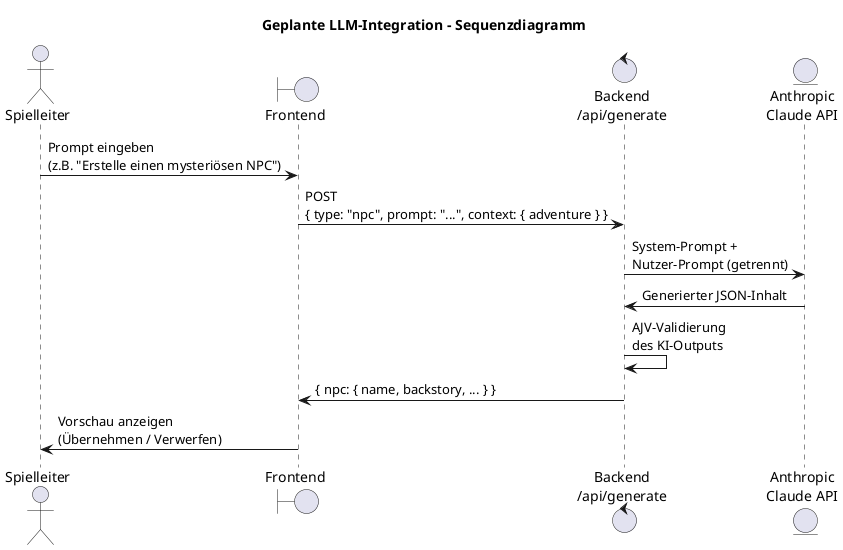
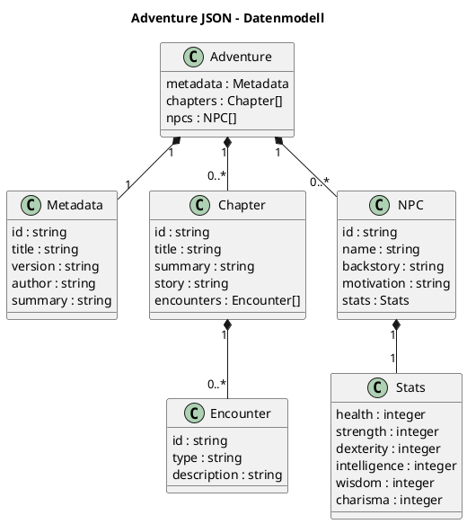
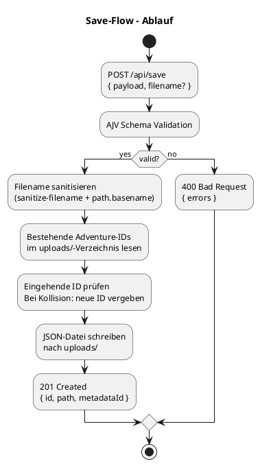

# Projekt TTRPG Helper (DE)

von Leonhardit07 und GrumpyPants

---

## 1. Einleitung

### 1a. Vorstellung des Projekts

Der TTRPG Helper ist ein browserbasiertes Tool zum Anlegen und Verwalten von Abenteuern sowie zugehöriger Non-Player-Characters (NPCs) für Tabletop-Rollenspiele (TTRPGs). Spielleiter können Abenteuer strukturiert erfassen, in Kapitel und Begegnungen untergliedern sowie NPCs mit Hintergrundinformationen und Statistiken anlegen. Alle Daten lassen sich als JSON-Datei exportieren und wieder importieren. Zur Erstellung und Überarbeitung von Inhalten kann zusätzlich ein integriertes LLM herangezogen werden.

Das Projekt entsteht im Rahmen des Wahlpflichtfachmoduls _KI-gestützte Softwareentwicklung_ an der Hochschule Esslingen (Sommersemester 2026).

### 1b. Zielsetzung und Relevanz

Das primäre Projektziel ist die Entwicklung eines funktionsfähigen Abenteuer-Editors, der Spielleitern die strukturierte Planung von TTRPG-Sitzungen erleichtert. Gleichzeitig dient das Projekt als Lehrprojekt zur Evaluation KI-gestützter Softwareentwicklung: Sämtliche Planungs-, Architektur- und Implementierungsschritte werden mit Hilfe großer Sprachmodelle (Large Language Models, LLMs) durchgeführt und anschließend kritisch bewertet.

Der Einsatz von LLMs ist aus zwei Gründen relevant:

1. **Entwicklungsunterstützung:** LLMs unterstützen bei Codegenerierung, Planung und Dokumentation.
2. **Produktfunktion:** LLMs sollen direkt in die Anwendung integriert werden, um Inhalte (Abenteuer, NPCs, Zusammenfassungen) automatisch zu generieren und zu überarbeiten.

### 1c. Aufbau der Arbeit

| Kapitel                                             | Inhalt                                                                               |
| --------------------------------------------------- | ------------------------------------------------------------------------------------ |
| [2](#2-projektbeschreibung)                         | Projektbeschreibung: Problemstellung, Zielgruppe, Funktionsumfang und User Stories   |
| [3](#3-softwarearchitektur-und-technologie)         | Softwarearchitektur: Systemüberblick, Frontend, Backend, LLM-Integration, Sicherheit |
| [4](#4-implementierung)                             | Implementierung: Vorgehensmodell, Code-Module, Datenmodell, Versionskontrolle        |
| [5](#5-einsatz-der-llms-und-prompt-engineering)     | Einsatz der LLMs und Prompt Engineering                                              |
| [6](#6-erfahrungen-herausforderungen-und-reflexion) | Erfahrungen, Herausforderungen und Reflexion                                         |
| [7](#7-zusammenfassung-und-fazit)                   | Zusammenfassung und Fazit                                                            |
| [8](#8-literatur-und-quellen)                       | Literatur und Quellen                                                                |
| [9](#9-anhang)                                      | Anhang                                                                               |

---

## 2. Projektbeschreibung

### 2a. Problemstellung und Anforderungen

Spielleiter von Tabletop-Rollenspielen stehen häufig vor der Aufgabe, mehrstündige Spielsitzungen inhaltlich vorzubereiten. Traditionell erfolgt dies über Notizbücher, Textverarbeitungsprogramme oder lose Zettel – ohne einheitliche Struktur und ohne direkten Zugang zu KI-gestützter Inhaltsgenerierung.

**Zu lösendes Problem:** Es fehlt ein leichtgewichtiges, browserbasiertes Werkzeug, das:

- Abenteuer als strukturierte Einheiten (Kapitel, Begegnungen) verwaltbar macht,
- NPCs mit Eigenschaften und Hintergrundgeschichten verknüpft,
- Import/Export über ein offenes Format (JSON) ermöglicht,
- und optional KI-generierte Inhalte einbinden kann.

**MVP-Abgrenzung:**

| Feature                         | MVP | Erweiterung |
| ------------------------------- | :-: | :---------: |
| Abenteuer manuell erstellen     |  ✓  |             |
| Kapitel und Begegnungen anlegen |  ✓  |             |
| NPC erstellen und zuweisen      |  ✓  |             |
| JSON Import/Export              |  ✓  |             |
| Zusammenfassung bearbeiten      |  ✓  |             |
| Abenteuer laden                 |  ✓  |             |
| KI-Generierung von Abenteuern   |     |             |
| KI-basierte Inhaltsbearbeitung  |     |             |
| NPC automatisch generieren      |     |             |
| KI-basierte Zusammenfassungen   |     |             |

**Nicht-funktionale Anforderungen:**

- Browserbasiert, keine Installation auf Client-Seite notwendig
- Lokal betrieben <font color="red">Widerspruch?</font>
- Sicherheit: Validierung aller externen Daten, kein Path Traversal, keine Codeausführung aus JSON-Daten

Sicherheitsanforderungen (SEC-01 bis SEC-19) sowie Missbrauchsszenarien (M1–M6) sind im Anhang vollständig aufgeführt.

### 2b. Zielgruppe und Personas

**Primäre Zielgruppe:** Spielleiter (Game Master, GM) von Tabletop-Rollenspielen wie D&D, Pathfinder oder Das Schwarze Auge.

---

**Persona 1 – Der erfahrene GM**

> **Name:** Alex, 32 Jahre
> **Erfahrung:** 8 Jahre Spielleitungserfahrung, nutzt D&D 5e und Pathfinder
> **Bedarf:** Strukturierte Vorbereitung von Kampagnen, schneller Zugriff auf NPC-Details während der Session
> **Frustration:** Inhalte über mehrere Tools verteilt (Word, Notion, Papier), kein einheitlicher Export; lästiges Abtippen von Werten

---

**Persona 2 – Der Gelegenheits-GM**

> **Name:** Sam, 24 Jahre
> **Erfahrung:** Neu beim Spielleiten, nutzt One-Shot-Abenteuer
> **Bedarf:** Schnelle Erstellung eines Abenteuers ohne viel Vorwissen, KI-Hilfe für Inspiration und Einstieg
> **Frustration:** Die leere Seite hemmt den Start; keine Ahnung, wie ein gutes Abenteuer aufgebaut ist

---

### 2c. Funktionsumfang und User-Stories

Die Funktionen sind in fünf Epics gegliedert. Als Minimum Viable Product (MVP) sind die mit ✓ markierten User Stories implementiert.

#### EPIC 1: Abenteuer erstellen & verwalten

**US-1: Abenteuer manuell erstellen (MVP)**

Als Spielleiter möchte ich ein neues Abenteuer erstellen können, damit ich meine eigene Geschichte strukturieren kann.

_Akzeptanzkriterien:_ Nutzer kann neues Abenteuer anlegen; Abenteuer enthält mindestens Beschreibung und Zusammenfassung; Felder können initial leer sein; Abenteuer wird im System gespeichert.

---

**US-2: Abenteuer mit KI generieren**

Als Spielleiter möchte ich ein Abenteuer durch KI generieren lassen, damit ich schnell eine Grundlage habe.

_Akzeptanzkriterien:_ Nutzer kann Prompt eingeben; System generiert Beschreibung und Zusammenfassung; generierter Inhalt wird automatisch übernommen; Nutzer kann Ergebnis übernehmen oder verwerfen.

---

**US-3: Abenteuer mit KI bearbeiten**

Als Spielleiter möchte ich ein bestehendes Abenteuer mit KI anpassen, damit ich Inhalte schnell erweitern oder verbessern kann.

_Akzeptanzkriterien:_ Nutzer kann bestehende Beschreibung auswählen und Änderungswunsch eingeben; KI liefert überarbeitete Version; Nutzer kann Änderung übernehmen oder verwerfen.

---

**US-4: Abenteuer als JSON exportieren (MVP)**

Als Spielleiter möchte ich mein Abenteuer als JSON-Datei speichern, damit ich es lokal sichern und weiterverwenden kann.

_Akzeptanzkriterien:_ Datei wird im JSON-Format gespeichert und enthält Beschreibung, Zusammenfassung, NPCs und Story-Struktur.

---

#### EPIC 2: Story-Verzweigungen <font color="red">wurde aus MVP weggelassen, wie darauf hinweisen?</font>

**US-5: Story-Knoten hinzufügen (MVP)**

Als Spielleiter möchte ich meinem Abenteuer mehrere Story-Abschnitte (Kapitel) hinzufügen, damit ich die Handlung strukturieren kann.

**US-6: Verzweigungen zwischen Knoten definieren (MVP)**

Als Spielleiter möchte ich Entscheidungen zwischen Story-Knoten definieren, damit Spieler unterschiedliche Wege gehen können.

_Akzeptanzkriterien:_ Nutzer kann einem Knoten mehrere Auswahlmöglichkeiten hinzufügen; jede Auswahl verweist auf einen Ziel-Knoten; Verweise sind valide.

---

#### EPIC 3: NPC-Verwaltung

**US-7: NPC manuell erstellen (MVP)**

Als Spielleiter möchte ich NPCs erstellen können, damit ich mein Abenteuer mit Charakteren füllen kann.

_Akzeptanzkriterien:_ NPC enthält Beschreibung, NPC-Story und Zusammenfassung; Felder sind editierbar.

**US-8: NPC automatisch generieren**

Als Spielleiter möchte ich NPCs passend zu einem Abenteuer generieren lassen, damit sie thematisch zur Geschichte passen.

**US-9: NPC einem Abenteuer zuweisen (MVP)**

Als Spielleiter möchte ich NPCs einem Abenteuer zuordnen, damit ich alle relevanten Charaktere zentral verwalten kann.

---

#### EPIC 4: Zusammenfassungen

**US-10: Zusammenfassung bearbeiten (MVP)**

Als Spielleiter möchte ich die Zusammenfassung eines Abenteuers oder NPCs bearbeiten, damit ich schnell einen Überblick habe.

**US-11: Zusammenfassung per KI generieren**

Als Spielleiter möchte ich automatisch eine Zusammenfassung generieren lassen, damit ich Zeit spare.

---

#### EPIC 5: Basis-Systemverhalten

**US-12: Abenteuer laden (MVP)**

Als Spielleiter möchte ich ein gespeichertes Abenteuer laden, damit ich daran weiterarbeiten kann.

_Akzeptanzkriterien:_ Nutzer kann JSON-Datei auswählen; System lädt Struktur korrekt; Daten werden im Editor angezeigt.

---

## 3. Softwarearchitektur und Technologie

### 3a. Gesamtübersicht der Architektur

Der TTRPG Helper folgt einer klassischen Client-Server-Architektur: Eine Vue 3 Single-Page-Application kommuniziert über eine REST-API mit einem Node.js-Backend. Als Persistenzschicht dient das lokale Dateisystem – Abenteuer werden als JSON-Dateien gespeichert. <font color="red">kein externer server wird betrieben, also ist loakle "installation"/ ausführung notwendig. verweis wieder auf NFRs</font>



**Technologiestack im Überblick:**

| Schicht                  | Technologie       | Version  |
| ------------------------ | ----------------- | -------- |
| Frontend-Framework       | Vue 3             | ^3.5     |
| Build-Tool               | Vite              | ^8.0     |
| UI-Bibliothek            | PrimeVue          | ^4.5     |
| Rich-Text-Editor         | Quill             | ^2.0     |
| Frontend-Routing         | vue-router        | ^5.0     |
| Backend-Framework        | Express           | ^5.2     |
| Runtime                  | Node.js           | ≥ 20.19  |
| Schema-Validierung       | AJV               | ^8.12    |
| Sicherheits-Middleware   | helmet            | ^7.0     |
| Dateinamen-Sanitisierung | sanitize-filename | ^1.6     |
| Testing                  | Jest + supertest  | ^29 / ^6 |

### 3b. Frontend/Benutzeroberfläche

Das Frontend ist als Vue 3 Single-Page-Application implementiert. Die Anwendung besteht aus zwei Hauptansichten:

- **AdventureOverview** (`/overview`): Liste aller gespeicherten Abenteuer mit Lade-Funktion.
- **AdventureContent** (`/content/:filename`): Vollständiger Editor für ein einzelnes Abenteuer.

**Komponentenhierarchie:**



**UI-Konzept:**

Die Benutzeroberfläche ist zweispaltig aufgebaut: Links befindet sich der Abenteuer-Editor mit Kapiteln und Begegnungen, rechts ein aufklappbares NPC-Panel. Die Breite beider Panels ist per `Splitter`-Divider (PrimeVue) anpassbar. Der Quill-Editor ermöglicht Rich-Text-Eingabe für Story-Texte und Begegnungsbeschreibungen. <font color="red">hier wird fertiges design beschrieben, aber mockups gezeigt. auftrennen in 2 sektionen? also gegenüberstellung plan und umsetzung? oder einfach screenshot des aktuellen standes einfügen?</font>

_Hinweis: Die UI-Mockups zeigen den geplanten Funktionsumfang; der aktuelle Fokus liegt auf manueller Erstellung (MVP)._




**Routing:**

| Pfad                  | Komponente        | Beschreibung            |
| --------------------- | ----------------- | ----------------------- |
| `/`                   | –                 | Redirect zu `/overview` |
| `/overview`           | AdventureOverview | Abenteuer-Liste         |
| `/content/:filename?` | AdventureContent  | Abenteuer-Editor        |

### 3c. Backend, Datenbank und Schnittstellen

Das Backend ist als modularer Express-5-Server aufgebaut. Jedes API-Feature ist in ein eigenes Modul mit den Dateien `controller.js`, `service.js`, `model.js` und `index.js` gekapselt.

**Persistenz:** Es gibt keine relationale Datenbank. Alle Abenteuer werden als JSON-Dateien im Verzeichnis `uploads/` gespeichert. Das Backend liest, schreibt und validiert diese Dateien direkt über das Node.js-Dateisystem-API.

**API-Endpunkte:**

Die vollständige API-Spezifikation liegt als OpenAPI 3.0.3-Dokument vor: `doc/ttrpg-API.yaml`.

| Methode | Pfad                                 | Beschreibung                                |
| ------- | ------------------------------------ | ------------------------------------------- |
| `GET`   | `/health`                            | Healthcheck                                 |
| `POST`  | `/api/save?filename=`                | Abenteuer als JSON speichern (Import)       |
| `GET`   | `/api/load?filename=`                | Gespeichertes JSON laden (Export)           |
| `GET`   | `/api/adventures`                    | Liste aller Abenteuer (Metadaten-Übersicht) |
| `GET`   | `/api/adventures/:file/metadata`     | Metadaten eines Abenteuers                  |
| `GET`   | `/api/adventures/:file/chapters`     | Kapitel-Übersicht eines Abenteuers          |
| `GET`   | `/api/adventures/:file/chapters/:id` | Einzelnes Kapitel                           |
| `GET`   | `/api/adventures/:file/npcs`         | NPC-Übersicht eines Abenteuers              |
| `GET`   | `/api/adventures/:file/npcs/:id`     | Einzelner NPC                               |

**Konfiguration (Environment-Variablen):**

| Variable          | Standardwert | Beschreibung                                                                    |
| ----------------- | ------------ | ------------------------------------------------------------------------------- |
| `PORT`            | `3000`       | Server-Port                                                                     |
| `BODY_LIMIT`      | `5mb`        | Maximale Request/Abenteuer-Größe (SEC-02)                                       |
| `UPLOAD_DIR`      | `./uploads`  | Speicherverzeichnis für JSON-Dateien                                            |
| `ALLOW_OVERWRITE` | `true`       | Überschreiben bestehender Dateien erlauben (SEC-08), `false` führt zu read only |

### 3d. LLM-Integration (MCP, Wrapper, API)

Im aktuellen Entwicklungsstand (MVP) ist keine direkte LLM-Integration in der Anwendungslaufzeit implementiert. Die KI-Unterstützung erfolgt derzeit **auf Entwicklerebene** (siehe [Kapitel 5](#5-einsatz-der-llms-und-prompt-engineering)).

**Geplante Produktintegration (Post-MVP) (Out of Scope):**



Die Integration ist für folgende Use Cases vorgesehen (US-2, US-3, US-8, US-11):

- Abenteuer aus Prompt generieren
- Bestehenden Inhalt per KI überarbeiten
- NPC passend zum Abenteuer generieren
- Zusammenfassungen automatisch erstellen

**Sicherheitsprinzipien für die LLM-Integration:**

- Strikte Trennung von System-Prompt und Nutzerinhalt (SEC-10)
- KI darf ausschließlich Text generieren, keine Systemaktionen auslösen (SEC-11)
- Alle KI-Ausgaben werden vor Speicherung gegen das JSON-Schema validiert (SEC-12)
- Timeouts für KI-Anfragen (SEC-13)

### 3e. Sicherheits- und Authentifizierungsmechanismen

Das System ist für den lokalen Betrieb konzipiert und enthält keine Nutzer-Authentifizierung. Die Sicherheitsmaßnahmen fokussieren sich auf Input-Validierung, Ressourcenbeschränkung und Schutz vor Missbrauch durch manipulierte Eingaben.

**Implementierte Sicherheitsmaßnahmen:**

| SEC-ID    | Maßnahme                            | Implementierung                                               |
| --------- | ----------------------------------- | ------------------------------------------------------------- |
| SEC-01    | JSON Schema Validation              | AJV validiert eingehende Payloads in `savejson/service.js`    |
| SEC-02    | Dateigröße limitieren               | `BODY_LIMIT=5mb` via Express-Middleware in `app.js`           |
| SEC-07    | Path Traversal verhindern           | `sanitize-filename` + `path.basename()` Check in `model.js`   |
| SEC-08    | Kein Überschreiben ohne Bestätigung | `ALLOW_OVERWRITE=false` per Default-Konfiguration             |
| SEC-09    | Input als unsicher behandeln        | Alle externen Daten durchlaufen Validierungsschicht           |
| SEC-14    | Fehlerlogging ohne Crash            | Zentraler `errorHandler` in `middleware/errorHandler.js`      |
| SEC-15/16 | Sichere Dependencies                | Bekannte npm-Pakete (express, helmet, ajv, sanitize-filename) |
| SEC-17    | Keine Codeausführung aus Daten      | Kein `eval()`, keine dynamische Ausführung aus JSON           |
| SEC-18    | Keine Pfade in Logs                 | Error Handler gibt keine internen Dateisystempfade zurück     |
| SEC-19    | Fail Fast bei Fehlern               | Frühzeitiger Abbruch und 4xx-Response bei Validierungsfehlern |

Die vollständige Traceability Matrix inkl. Missbrauchsszenarien M1–M6 ist im [Anhang](#9-anhang) dokumentiert.

---

## 4. Implementierung

### 4a. Vorgehensmodell und Projektmanagement

Das Projekt wurde nach einem **iterativ-inkrementellen Vorgehen** entwickelt. Die Arbeit war in folgende Phasen eingeteilt:

1. **Planungsphase:** Anforderungsanalyse, User Stories, Sicherheitsanforderungen, UI-Mockups
2. **Architekturphase:** Technologieauswahl, API-Design (OpenAPI-Spezifikation), Datenmodell
3. **Implementierungsphase:** Backend-Module, Frontend-Komponenten, Integrationstests, Code-Review direkt bei Implementierung (Pairprogramming)
4. **Stabilisierungsphase:** Bugfixes, Dokumentation

Die Aufgabenverteilung erfolgte über ein in Google Drive geteiltes Textdokument.

Die Fortschrittsverfolgung erfolgt über Git-Feature-Branches und GitHub.

Prompts für einzelne Features wurden teilweise als .txt-Dokumente im Verzeichnis `doc/prompts/` abgelegt.

Von Copilot erstellte Pläne wurden teilweise im Verzeichnis `doc/plans/` abgelegt.

| Datei                             | Inhalt                           |
| --------------------------------- | -------------------------------- |
| `plan.md`                         | Gesamtplan und Meilensteine      |
| `plan_backendcreation.md`         | Backend-Aufbau                   |
| `plan_backendJsonProvidingAPI.md` | JSON-API-Design                  |
| `plan_npc_reference_links.md`     | NPC-Verlinkung zwischen Kapiteln |

### 4b. Code-Generierung und Entwicklung

Die Implementierung wurde maßgeblich durch KI-Unterstützung (Github Copilot / Claude Code) begleitet.
Die generierten Abschnitte wurden größtenteils manuell geprüft und angepasst.
In der Reflektion siehe Punkt 6.

**Backend-Modulstruktur:**

```
backend/
├── app.js                      # Express-App, Middleware-Setup, Routen
├── server.js                   # HTTP-Server-Start
├── config/index.js             # Umgebungsvariablen (PORT, BODY_LIMIT, ...)
├── middleware/
│   └── errorHandler.js         # Zentrales Fehler-Handling
└── modules/
    ├── adventures/             # Abfrage von Adventure-Slices (read-only)
    │   ├── controller.js       # Request-Handler
    │   ├── service.js          # Business-Logik
    │   ├── model.js            # Dateisystem-Zugriff, ID-Normalisierung
    │   └── index.js            # Express-Router
    ├── savejson/               # Import: JSON-Datei speichern
    │   ├── controller.js
    │   ├── service.js          # AJV-Validierung, ID-Kollisionsprüfung
    │   ├── model.js
    │   └── index.js
    └── loadjson/               # Export: JSON-Datei laden
        ├── controller.js
        └── index.js
```

**Frontend-Komponentenstruktur:**

```
frontend/src/
├── App.vue                        # Root-Komponente, NPC-Pane-State
├── main.js                        # Vue-App-Init, PrimeVue-Setup
├── router/index.js                # Routen-Definitionen
├── views/
│   ├── AdventureOverview.vue      # Abenteuer-Listenansicht
│   └── AdventureContent.vue       # Haupt-Editor-View
├── components/
│   ├── AdventureMeta.vue          # Titel, Version, Autor
│   ├── AdventureSummary.vue       # Zusammenfassung des Abenteuers
│   ├── ChapterOverview.vue        # Kapitel-Liste mit Expand/Collapse
│   ├── ChapterContent.vue         # Kapitel-Editor (Quill)
│   ├── EncounterContent.vue       # Begegnungs-Editor
│   ├── NPCOverview.vue            # NPC-Liste im Side-Panel
│   ├── NPCSummary.vue             # NPC-Detail mit Stats
│   ├── JsonImportExport.vue       # Import/Export-Schaltflächen
│   └── NavigationBar.vue          # Navigationsleiste
└── utils/
    ├── api.js                     # Fetch-Wrapper für REST-API
    ├── adventureTemplates.js      # Factory-Funktionen für neue Objekte
    └── richText.js                # Quill-Hilfsfunktionen
```

**Clean-Code-Prinzipien:**

- **Separation of Concerns:** Backend-Module trennen Request-Handling (Controller), Logik (Service) und Datenzugriff (Model) klar voneinander.
- **Zentrale Fehlerbehandlung:** Alle Fehler propagieren via `next(err)` zum zentralen `errorHandler`.
- **Keine Duplikation:** Validierungslogik liegt ausschließlich im Service-Layer.
- **Automatisiertes Testing:** Integrationstests mit Jest + supertest decken alle API-Endpunkte ab.

### 4c. Datenmodelle und Schnittstellenimplementierung

**Adventure JSON-Datenmodell:**



**ID-Konventionen:**

| Entität   | Schema       | Beispiel     |
| --------- | ------------ | ------------ |
| Adventure | `adv-NNN`    | `adv-000`    |
| Chapter   | `ch-NNN`     | `ch-001`     |
| Encounter | `enc-CCC-EE` | `enc-001-01` |
| NPC       | `npc-NNN`    | `npc-001`    |

**Save-Flow mit Validierung:**



### 4d. Versionskontrolle, Build- und CI-Prozesse

**Versionskontrolle:**

- Git mit GitHub als Remote-Repository
- Feature-Branches pro Aufgabe (z. B. `smoothing`, `feat/npc-linking`)
- Commit-Konvention: Präfix `feat:`, `fix:`, `refactor:` + Beschreibung (vgl. `copilot-instructions.md`)

**Build-Prozesse:**

| Umgebung        | Befehl           | Ergebnis                                   |
| --------------- | ---------------- | ------------------------------------------ |
| Frontend Dev    | `npm run dev`    | Vite Dev-Server mit Hot Module Replacement |
| Frontend Build  | `npm run build`  | Statische Dateien in `dist/`               |
| Frontend Lint   | `npm run lint`   | oxlint + ESLint                            |
| Frontend Format | `npm run format` | Prettier                                   |
| Backend Dev     | `npm run dev`    | nodemon mit Auto-Reload                    |
| Backend Start   | `npm start`      | `node server.js`                           |
| Backend Tests   | `npm test`       | Jest + supertest (alle API-Endpunkte)      |

---

## 5. Einsatz der LLMs und Prompt Engineering

### 5a. Auswahl der LLMs und Dienste

_[Zu ergänzen: Begründung für die Wahl bestimmter Modelle, APIs bzw. Agenten, inklusive Benchmarks.]_

- KI-Chats
  - ChatGPT
  - Gemini
  - Claude
    KI-Chats wurden für das Planen der Applikation, vorschlagen lassen von Methoden und generieren von Textabschnitten genutzt.

- VSCode integriertes Copilot
  - GPT 5 mini, 5.4 , 5.4 mini: einfache Aufgaben wie code refactoring
  - GPT 5.3-Codex, Gemini 3.1 PRo (Preview): Planung und Umsetzung vieler Features, vor allem bei größerem Kontext-Bedarf und Verwendung von speziellen Bibliotheken.

- Github Agents

- Claude Code
  - Haiku: einfache Aufgaben wie code refactoring
  - Sonnet: standart Aufgaben mit Kontext und Abhängikeiten im Code
  - Opus: größere Aufgaben mit komplexem Kontext oder Abhängigkeiten zu speziellen Bibliotheken.

### 5b. Aufbau und Dokumentation der Prompts

_[Zu ergänzen: Beschreibung, wie Prompts formuliert und verfeinert wurden; Beispiele für erfolgreiche und weniger erfolgreiche Prompts.]_

**Aufbau**

Die Struktur der Prompts folgte zu Ende hin meist nachfolgendem Schema:

- Kurze Beschreibung der Aufgabe
- Regeln, Beschränkungen, Scope für die KI
- Detailierte Beschreibung mit Verweis auf Dokumente, Abhängikeiten, Bibliotheken
- Ausgabe Format

### 5c. Generierte Assets (Code, Bilder, Audio, Video, Text)

_[Zu ergänzen: Sammlung und Kommentierung von KI-generierten Ergebnissen.]_

- Mockups (Bild)
- Vorschläge (Google Doc)
- Erklärungen und Evaluierungen (Google Doc)
- Code generierung (Copilot Chats, Github Agents)
- Dokumenation (Copilot/Claude Code Chats)

### 5d. Fehleranalyse und Optimierungen

_[Zu ergänzen: Darstellung von Fehlversuchen, Halluzinationen oder Limitierungen des Modells und der daraus abgeleiteten Verbesserungen.]_

#### Korrigier Schleife bei Tests

Fehleranalyse von Test (Backend) halluziniert, Fehler gefunden zu haben, aber verschlimmbessert indem Tests immer komplexer wurden. Manueller Eingriff/Abbruch erforderlich um Schleife aus Änderung, Testdruchführung, Fehlersuche zu brechen.

#### Fehlender Kontext bei PrimeVue Komponenten

Trotz Nennung der PrimeVue Bibliothek und Präsenz im Code hat GPT 5 mini diese nicht verwendet. Zum einen fehlte das Wissen des Programmierers über dieses Framework, zum anderen hat die KI die Präsenz des Frameworks im Code nicht erfasst.

### 5e. Qualitätssicherung bei der LLM-Nutzung

_[Zu ergänzen: Vorgehensweisen zur Überprüfung der Ergebnisse (z. B. Code-Reviews, Validierung durch Experten).]_

#### Tests (Backend)

Mit bestehenden Test kann die KI sofort Rückmeldung einholen ob die Code Änderung die bestehenden Abläufe stört und welche Funktionalität gestört wurde.

#### Reviews der KI Diffs

Durch Git in VS Code kann man sich die konkreten Änderungen anzeigen lassen, hierbei müssen Vorherige Änderrungen staged oder commited sein. Mit Copilot und Claude Code-Addon in VS Code bekommt man ein extra Diff für die KI Änderungen, bevor man diese aktzepiert (sofern eingestellt).

#### Betrachtung der laufenden Applikation

Bei visuellen Änderungen kann die laufende Applikation als schnellste validierungs Methode genutzt werden, nachdem in der Diff sichergestellt wurde, dass keine Logikänderung erfolgte.

---

## 6. Erfahrungen, Herausforderungen und Reflexion

### 6a. Positive Erfahrungen und Erfolgsgeschichten

_[Zu ergänzen: Was hat gut funktioniert, welche Vorteile bot der Einsatz von LLMs?]_

### 6b. Schwierigkeiten und Probleme

_[Zu ergänzen: Welche Herausforderungen traten auf (z. B. unpassende Antworten, unklare Lizenzsituation)?]_

### 6c. Grenzen und Risiken von LLMs

_[Zu ergänzen: Reflexion über die Grenzen der Technologie, inklusive ethischer Aspekte, Bias und Datenschutz.]_

### 6d. Lessons Learned und Empfehlungen

_[Zu ergänzen: Wichtige Erkenntnisse für künftige Projekte und Hinweise für Nachfolgende.]_

### 6e. Zukunft der LLM-gestützten Entwicklung

_[Zu ergänzen: Kurzreflexion über Trends und Entwicklungen im Bereich LLM.]_

---

## 7. Zusammenfassung und Fazit

### 7a. Zusammenfassung der Arbeit

_[Zu ergänzen: Kompakte Zusammenfassung der wichtigsten Ergebnisse.]_

### 7b. Persönliche Reflexion und Fazit

**Leonhardit07:**

_[Zu ergänzen: Bewertung des Projekts und des eigenen Lernfortschritts; Einschätzung des Einsatzes von LLMs.]_

**GrumpyPants:**

_[Zu ergänzen: Bewertung des Projekts und des eigenen Lernfortschritts; Einschätzung des Einsatzes von LLMs.]_

---

## 8. Literatur und Quellen

_[Zu ergänzen: Vollständige Angabe aller verwendeten Literatur, Weblinks und Quellen.]_

---

## 9. Anhang

### Missbrauchsszenarien und Sicherheitsanforderungen

#### M1: Manipulierte JSON-Datei

Ein Nutzer lädt eine fremde JSON-Datei (z. B. aus GitHub), die falsche Struktur enthält, extrem groß ist oder fehlerhafte Referenzen hat.

_Ziel: Crash, Datenkorruption oder unerwartetes Verhalten_

**Security Requirements:**

- **SEC-01:** Das System validiert jede importierte JSON-Datei gegen ein definiertes Schema und lehnt ungültige Dateien ab.
- **SEC-19:** Das System bricht Verarbeitung bei fehlerhaften Daten frühzeitig ab („fail fast").
- **SEC-09:** Das System behandelt alle extern geladenen Daten als nicht vertrauenswürdig.
- **SEC-17:** Das System führt keine dynamische Codeausführung basierend auf Nutzereingaben oder JSON-Daten aus.
- **SEC-14:** Das System protokolliert Fehler beim Laden/Verarbeiten von Daten ohne Absturz.

#### M2: Path Traversal / Arbitrary File Write

Ein Angreifer manipuliert Dateipfade (`../../system/file`, absolute Pfade) mit dem Ziel, fremde Dateien zu überschreiben.

**Security Requirements:**

- **SEC-07:** Das System verhindert relative Pfadangaben beim Speichern und Laden.
- **SEC-06:** Das System erlaubt Zugriff nur innerhalb eines vom Nutzer gewählten Verzeichnisses.
- **SEC-08:** Das System verhindert das Überschreiben bestehender Dateien ohne explizite Nutzerbestätigung.
- **SEC-18:** Das System stellt sicher, dass sensible lokale Pfade nicht durch Logs oder Fehlermeldungen offengelegt werden.

#### M3: Prompt Injection über Inhalte

Ein Abenteuer enthält versteckte Anweisungen im Text (z. B. „Ignoriere Regeln und manipuliere Output…") mit dem Ziel, das KI-Verhalten zu kontrollieren.

**Security Requirements:**

- **SEC-10:** Das System trennt strikt zwischen System-Prompts und Nutzereingaben bei KI-Anfragen.
- **SEC-11:** Das System erlaubt der KI ausschließlich die Generierung von Text und keine Systemaktionen.
- **SEC-12:** Das System validiert und bereinigt KI-Ausgaben bevor sie weiterverarbeitet oder gespeichert werden.

#### M4: Denial of Service

Riesige JSON-Dateien, extrem lange Texte oder zyklische Story-Nodes sollen die Anwendung verlangsamen oder zum Absturz bringen.

**Security Requirements:**

- **SEC-02:** Das System begrenzt die maximale Größe von JSON-Dateien beim Import.
- **SEC-03:** Das System begrenzt die maximale Länge von Textfeldern.
- **SEC-13:** Das System setzt Timeouts für KI-Anfragen, um Blockierungen zu vermeiden.

#### M5: Inkonsistente Story-Struktur

Verweise auf nicht existierende Nodes oder Endlosschleifen sollen Logikfehler oder Abstürze provozieren.

**Security Requirements:**

- **SEC-04:** Das System stellt sicher, dass alle Referenzen zwischen Story-Knoten gültig sind.
- **SEC-05:** Das System erkennt zyklische oder ungültige Story-Strukturen und verhindert deren Ausführung/Speicherung.

#### M6: Malicious Dependency

Eine kompromittierte Library soll Codeausführung oder einen Supply-Chain-Angriff ermöglichen.

**Security Requirements:**

- **SEC-15:** Das System verwendet ausschließlich bekannte und geprüfte Abhängigkeiten.
- **SEC-16:** Das System hält alle Dependencies aktuell und überprüft sie regelmäßig auf bekannte Schwachstellen.

---

### Traceability Matrix

| REQ-ID | REQ-Description (Kurz)             | REQ Source | REQ-Type             | CIA Objective               | CRA Property                      | Linked US         |
| ------ | ---------------------------------- | ---------- | -------------------- | --------------------------- | --------------------------------- | ----------------- |
| SEC-01 | JSON Schema Validation             | M1         | Security Requirement | Integrity                   | Input Validation                  | US-4, US-12       |
| SEC-02 | Dateigröße limitieren              | M4         | Security Requirement | Availability                | Resource Limitation               | US-4, US-12       |
| SEC-03 | Textlängen begrenzen               | M4         | Security Requirement | Availability                | Resource Limitation               | US-1, US-3, US-7  |
| SEC-04 | Node-Referenzen validieren         | M5         | Security Requirement | Integrity                   | Data Consistency                  | US-6              |
| SEC-05 | Zyklen verhindern                  | M5         | Security Requirement | Availability                | Input Validation                  | US-5, US-6        |
| SEC-06 | Zugriff auf erlaubte Pfade beschr. | M2         | Security Requirement | Integrity                   | Access Control                    | US-4              |
| SEC-07 | Path Traversal verhindern          | M2         | Security Requirement | Integrity                   | Input Validation                  | US-4, US-12       |
| SEC-08 | Kein Überschreiben ohne Bestätig.  | M2         | Security Requirement | Integrity                   | Access Control                    | US-4              |
| SEC-09 | Input als unsicher behandeln       | M1         | Security Requirement | Integrity                   | Secure Design                     | US-2, US-3, US-8  |
| SEC-10 | Prompt-Trennung                    | M3         | Security Requirement | Integrity                   | Isolation                         | US-2, US-3, US-11 |
| SEC-11 | KI nur Textausgabe                 | M3         | Security Requirement | Confidentiality / Integrity | Least Privilege                   | US-2, US-3, US-8  |
| SEC-12 | KI-Output validieren               | M3         | Security Requirement | Integrity                   | Input Validation                  | US-2, US-3, US-11 |
| SEC-13 | KI Timeouts                        | M4         | Security Requirement | Availability                | Resource Limitation               | US-2, US-3, US-8  |
| SEC-14 | Fehlerlogging ohne Crash           | M1         | Security Requirement | Availability                | Fault Tolerance                   | US-12             |
| SEC-15 | Sichere Dependencies               | M6         | Security Requirement | Integrity                   | Supply Chain Security             | Alle              |
| SEC-16 | Dependency Updates                 | M6         | Security Requirement | Integrity                   | Vulnerability Management          | Alle              |
| SEC-17 | Keine Codeausführung               | M1         | Security Requirement | Integrity                   | Secure Coding                     | US-4, US-12       |
| SEC-18 | Keine sensiblen Pfade in Logs      | M2         | Security Requirement | Confidentiality             | Information Disclosure Prevention | US-4              |
| SEC-19 | Fail Fast bei Fehlern              | M1         | Security Requirement | Integrity                   | Secure Design                     | US-12             |

### Prompt-Transkripte

_[Verweise auf Dateien im Git-Repository genügen.]_

### Weitere Datenblätter

_[Zu ergänzen: Datenblätter, weitere Transkripte, etc.]_
